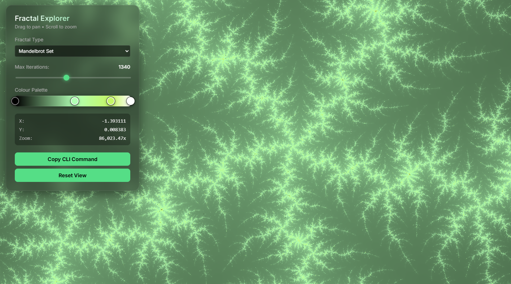

# CppFractals Explorer

A CUDA-accelerated Mandelbrot/Julia renderer with a native WinUI 3 desktop explorer (version 0.2.0).

- **FractalExplorer.exe**: live GPU preview, drag to pan, scroll to zoom, gradient palette editor, PNG save and a settings page.
- **CppFractals.exe**: command-line renderer, a developer tool only (used by the baseline script and the tests); it is not shipped in the app folder.

## Using the app

- A navigation rail on the left switches between the **Fractal**, **Colours** and **Settings** panes.
- The current coordinates are shown in an overlay at the bottom right of the preview.
- **Save** (top right, Ctrl+S) renders and writes a PNG to the save folder. Its dropdown, **Save as** (Ctrl+Shift+S), opens a dialog for size, smoothing, iterations and a destination. Progress is shown in a strip with a Cancel button. Save as iterations are capped at 100000.
- Settings are stored in `%LOCALAPPDATA%\FractalExplorer\settings.json`. The default save folder is `Fractal Explorer` inside your Pictures folder (the Windows known folder, which may be redirected, e.g. to OneDrive).




## Prerequisites

- Windows 10/11 x64 with an NVIDIA GPU and a current NVIDIA driver
- Visual Studio 2022 with the workloads "Desktop development with C++", ".NET desktop development" and "WinUI application development"
- CUDA Toolkit 12.9 (with its Visual Studio build customization)

## Build

From a VS 2022 Developer prompt:

```
msbuild CppFractals.sln /restore /m /p:Configuration=Release /p:Platform=x64
```

## Run

`src\FractalExplorer\bin\x64\Release\net8.0-windows10.0.19041.0\win-x64\FractalExplorer.exe`

That folder (FractalExplorer.exe, FractalCore.dll, runtime) is self-contained and can be copied anywhere. Only an NVIDIA driver is required on the target machine.

## Command line (developer tool)

```
x64\Release\CppFractals.exe <type> <width> <height> <maxIter> <xCenter> <yCenter> <zoom> <cx> <cy> <output.png> [--ss N] [t1 hex1 t2 hex2 ...]
```

- `type`: 0 = Mandelbrot, 1 = Julia (`cx`, `cy` is the Julia constant; ignored for Mandelbrot)
- `zoom`: half-width of the view in the complex plane
- `--ss N`: N x N supersampling per pixel
- Palette stops: `t` in [0,1] followed by a hex color without `#`; omit for the built-in palette

Example:

```
x64\Release\CppFractals.exe 0 3840 2160 400 -1.4002 0 0.1 0 0 my_mandelbrot.png
```

The CLI writes to whatever output path it is given. Renders written into the repo root (such as `output_*.png`) are not gitignored; do not commit them.

## Tests

Run the msbuild command above first: the tests copy the prebuilt native DLL and exe from `x64\Release`, and `dotnet build/test` cannot build the C++/CUDA projects. Then:

```
dotnet test tests\FractalExplorer.Tests\FractalExplorer.Tests.csproj -c Release -p:Platform=x64
```

To check that the renderer output is pixel-identical to a saved baseline exe:

```
pwsh -File tools\compare-baseline.ps1 -Baseline <path\to\baseline\CppFractals.exe> -Candidate x64\Release\CppFractals.exe
```
