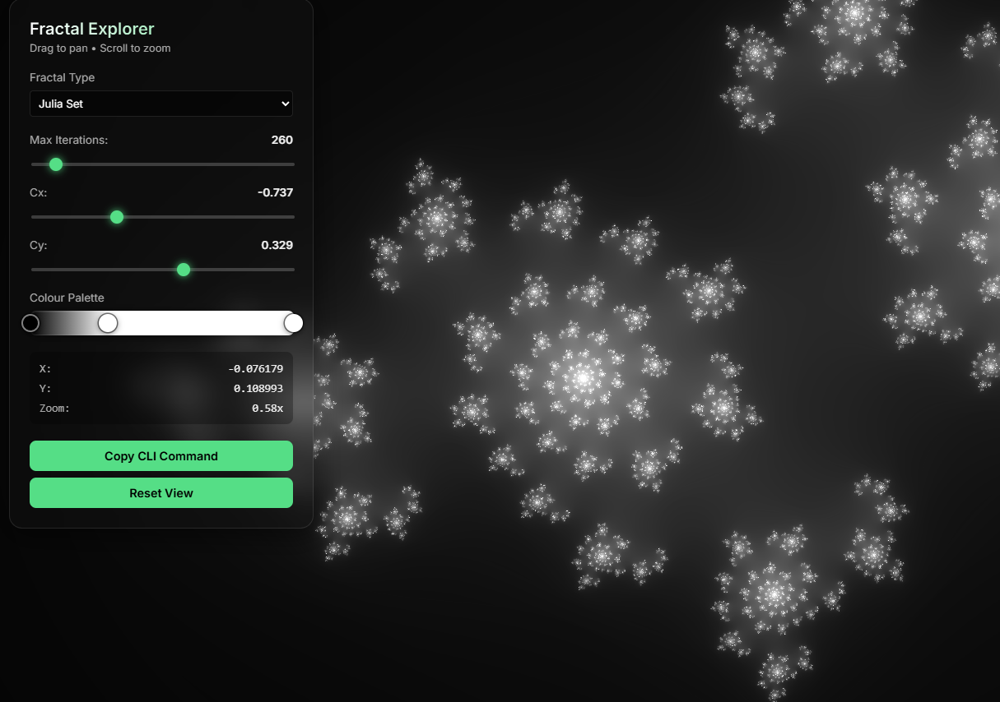

# CppFractals Explorer

A CUDA-accelerated Mandelbrot/Julia renderer with a native WinUI 3 desktop explorer and a command-line renderer.

- **FractalExplorer.exe**: live GPU preview, drag to pan, scroll to zoom, gradient palette editor, PNG export, and a button that copies the equivalent CLI command.
- **CppFractals.exe**: command-line renderer for batch or very large images.




## Prerequisites

- Windows 10/11 x64 with an NVIDIA GPU and a current NVIDIA driver
- Visual Studio 2022 with the workloads "Desktop development with C++", ".NET desktop development" and "WinUI application development"
- CUDA Toolkit 12.9 (with its Visual Studio build customization)

## Build

From a VS 2022 Developer prompt:

```
msbuild CppFractals.sln /restore /m /p:Configuration=Release /p:Platform=x64
```

## Run

`src\FractalExplorer\bin\x64\Release\net8.0-windows10.0.19041.0\win-x64\FractalExplorer.exe`

That folder (FractalExplorer.exe, FractalCore.dll, CppFractals.exe, runtime) is self-contained and can be copied anywhere. Only an NVIDIA driver is required on the target machine.

## Command line

```
x64\Release\CppFractals.exe <type> <width> <height> <maxIter> <xCenter> <yCenter> <zoom> <cx> <cy> <output.png> [--ss N] [t1 hex1 t2 hex2 ...]
```

- `type`: 0 = Mandelbrot, 1 = Julia (`cx`, `cy` is the Julia constant; ignored for Mandelbrot)
- `zoom`: half-width of the view in the complex plane
- `--ss N`: N x N supersampling per pixel
- Palette stops: `t` in [0,1] followed by a hex color without `#`; omit for the built-in palette

Example:

```
x64\Release\CppFractals.exe 0 3840 2160 400 -1.4002 0 0.1 0 0 my_mandelbrot.png
```

The Explorer's "copy command" button puts a 5000x5000 command like this on the clipboard. Running it from the repo root creates `output_<timestamp>.png` files there. They are not gitignored; do not commit them.

## Tests

After a full build (the tests copy the prebuilt native DLL and exe):

```
dotnet test tests\FractalExplorer.Tests
```

To check that the renderer output is pixel-identical to a saved baseline exe:

```
pwsh -File tools\compare-baseline.ps1 -Baseline <path\to\baseline\CppFractals.exe> -Candidate x64\Release\CppFractals.exe
```
